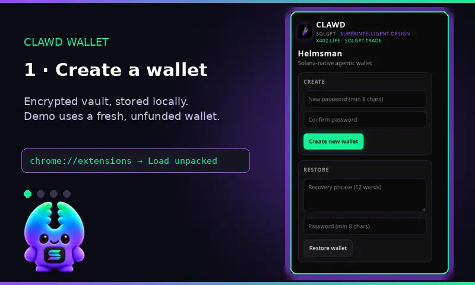
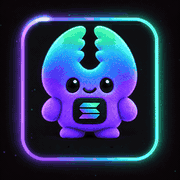
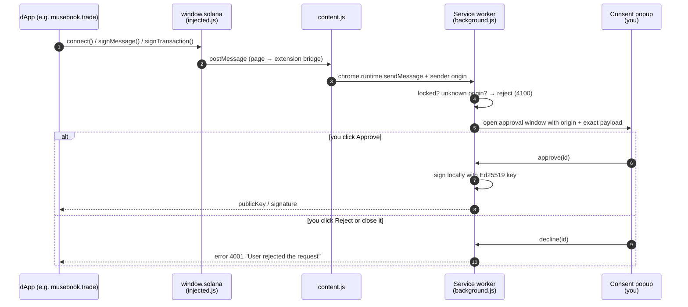
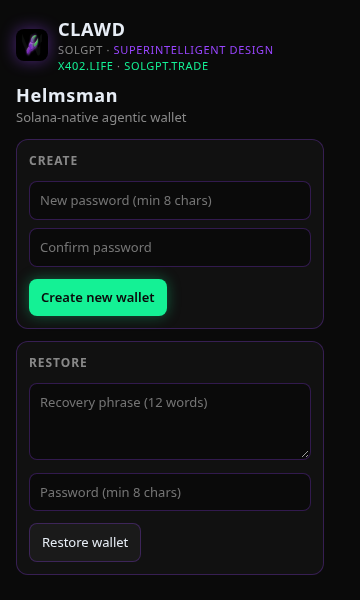
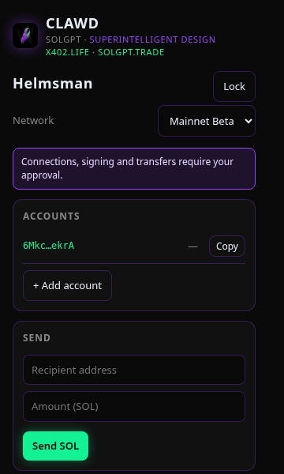
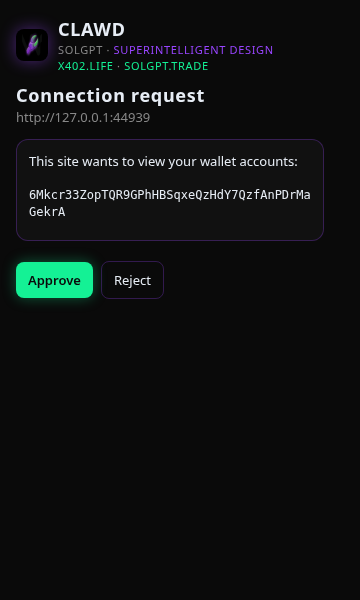
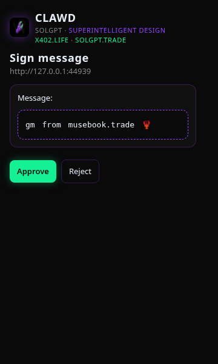

<div align="center">



<p>
  <a href="https://github.com/Solizardking/clawd-wallet/pulls"></a>
  
  
  
  <br/>
  
  
  
  <a href="SECURITY.md"></a>
  
</p>

**Solana-native Clawd / SolGPT wallet + agent surface for Chrome.**<br/> A `window.solana` provider where **every** new connection, signature and transfer waits for you to click **Approve**.

<a href="https://musebook.trade"><b>musebook.trade</b></a> · <a href="https://solgpt.trade"><b>solgpt.trade</b></a> · <a href="https://x402.life"><b>x402.life</b></a> · <a href="https://clawdmail.app"><b>clawdmail.app</b></a> · <a href="https://musebook.trade/buy-clawd"><b>$CLAWD</b></a>

</div>

---

<table>
<tr>
<td width="62%">



</td>
<td width="38%" align="center">



<sub><b>Clawd</b> guards the keys.<br/>Nothing signs without a click.</sub>

</td>
</tr>
</table>

<sub>Demo frames are real screenshots of v0.3.2, captured headless with <code>npm run box:launch -- --screenshots</code> using a freshly generated, unfunded test wallet in a throwaway profile.</sub>

## ✨ What it does

| Feature | Details |
| --- | --- |
| 🦞 **`window.solana` provider** | `connect`, `signMessage` (string or UTF-8 bytes), `signTransaction` and `signAndSendTransaction` (base64-serialized transactions) for dApps. |
| 🛡️ **Consent on everything** | New site connections, message signing, transaction signing and SOL transfers each open an approval window. Auto-approve is off, and old agent-mode settings are ignored. |
| 🔐 **Self-custodial vault** | BIP39 seed created on your device, encrypted with PBKDF2-SHA256 (600k) → AES-256-GCM in local extension storage. |
| 🌐 **Network + RPC control** | Mainnet / devnet / testnet, or your own RPC URL from the popup. |
| 🧾 **HTTP 402 untouched** | `402 Payment Required` responses pass straight through to the page. The wallet does not pay them for you. |
| 🚫 **Legacy relays disabled** | Backend `pay`, `sign`, `vision`, `computer` and `health` commands are rejected (`4200`) before they reach a backend or take a screenshot. |

## 🔁 Consent flow



Web pages can't call the popup's own commands (`popup_*`). A forged request from the page gets `4200`, and the browser test checks this.

## 📸 Screens

<table>
<tr>
<td align="center"><br/><sub>Create / restore</sub></td>
<td align="center"><br/><sub>Wallet</sub></td>
<td align="center"><br/><sub>Connection request</sub></td>
<td align="center"><br/><sub>Sign message</sub></td>
</tr>
</table>

## 🚀 Install (load unpacked)

1. Get a built extension: this repo's `dist/` folder, or run `npm run pack` and unzip `helmsman-extension.zip` (the zip isn't committed).
2. Open `chrome://extensions` in Chrome or any Chromium browser (Brave, Edge, Arc).
3. Turn on **Developer mode** (top right).
4. Click **Load unpacked** and pick `dist/` (or the unzipped `helmsman-extension/` folder that holds `manifest.json`).
5. Pin **Clawd Wallet** from the puzzle-piece menu.

> [!NOTE]
> v0.3.2 is not on the Chrome Web Store and has no GitHub release yet. The published v0.3.0 release came before the consent fix.

### Clone and build

Needs Node 20.19+ or 22.12+ (Vite's minimum).

```bash
git clone https://github.com/Solizardking/clawd-wallet.git
cd clawd-wallet
npm ci
npm run build        # → dist/ (load-unpacked ready)
```

## 🧪 Develop and test

```bash
npm run typecheck                 # tsc --noEmit
npm test                          # rebuilt-bundle security regressions + public derivation vectors
npx playwright install chromium   # once
npm run test:browser              # consent UI end-to-end in a disposable Chromium profile
npm run pack                      # optional: build + write helmsman-extension.zip
```

`npm run pack` writes `dist/config.json` from env vars:

- `HELMSMAN_PUBLIC_URL`: agent/backend API URL (default `http://localhost:8787`)
- `HELMSMAN_RPC_URL`: optional custom Solana RPC URL

If no `rpcUrl` is set, the wallet uses the public `https://api.mainnet-beta.solana.com`. You can also set a custom RPC and backend URL in the popup's settings. Don't commit an RPC URL that contains a private API key.

## 🤖 Run it on an agent box / headless Linux

`scripts/launch-chromium.mjs` starts Playwright's Chromium with the unpacked extension loaded into a **new throwaway profile** (a temp dir that is deleted on exit). It never uses your normal browser profile.

```bash
npm ci && npx playwright install chromium
npm run box:launch                         # headed (uses $DISPLAY) → opens https://musebook.trade
npm run box:launch -- --url https://solgpt.trade
npm run box:verify                         # headless: service worker up + window.solana injected, then exit
npm run box:launch -- --screenshots ./shots  # headless: fresh unfunded test wallet → popup + consent screenshots
```

Flags: `--headless`, `--keep-profile`, `--profile <dir>` (a named profile is kept). The profile starts with no wallet. Only `--screenshots` creates one: a new, unfunded test wallet in the throwaway profile. Its recovery phrase is never printed or saved. **Never import a funded wallet into an automation profile.**

## 🌐 Works with

| Project | What it is |
| --- | --- |
| 🧠 [**musebook.trade**](https://musebook.trade) | Agent directory and market desk. Agent docs: [`/SKILL.md`](https://musebook.trade/SKILL.md) · MCP server: [`/mcp`](https://musebook.trade/mcp) · [`/buy-clawd`](https://musebook.trade/buy-clawd) · Solana Action: [`/blink`](https://musebook.trade/blink) · [`/crawler`](https://musebook.trade/crawler) |
| 📈 [**solgpt.trade**](https://solgpt.trade) | SolGPT desk |
| 💸 [**x402.life**](https://x402.life) | HTTP 402 / x402 payments. The wallet passes 402s through and never pays automatically. |
| 📬 [**clawdmail.app**](https://clawdmail.app) | Clawd mail |
| 🦞 [**$CLAWD**](https://musebook.trade/buy-clawd) | The Clawd token on Solana |

Any dApp that looks for `window.solana` can connect. Each new origin still needs your approval.

## 🔑 Permissions and why

| Permission | Why |
| --- | --- |
| `storage` | Saves your encrypted vault, accounts, network and settings locally on your device. |
| `activeTab`, `tabs` | Existing tab permissions; sender metadata identifies the requesting site. Screenshot commands are disabled. |
| Content script on `http://*/*`, `https://*/*` | Injects the `window.solana` provider so dApps can detect and connect to the wallet. |
| `injected.js` web-accessible resource | The provider script that's injected into the page. |
| Host permissions `https://*/*`, `http://*/*`, `http://localhost:8787/*` | Lets the wallet talk to the Solana RPC you choose. Legacy backend payment/signing relays are disabled. |

## 🗂️ Project layout

```
public/      manifest.json, popup.html, icons, config.json, brand assets
src/         background (service worker), content, injected provider, popup, wallet (keyring/vault)
scripts/     pack + zip helpers, launch-chromium.mjs (throwaway-profile launcher)
tests/       security regressions + Playwright consent test
docs/        verification artifacts, consent-fix notes, README assets
dist/        built, load-unpacked-ready extension
```

## 🛡️ Security

This is a self-custodial wallet. Full posture: **[SECURITY.md](SECURITY.md)**.

- Your seed phrase is created on your device and stored encrypted with your password (WebCrypto) in
  the extension's local storage. Nobody else has a copy.
- **Never share your seed phrase or password** with anyone: not a website, a support account, or an AI
  agent. No legitimate service will ask for it.
- New site connections, signing and transfers require approval in the wallet popup.
  Previously persisted agent auto-approve settings are ignored.
- Webpages cannot invoke popup management or approval commands. Legacy `pay`, `sign`, `vision`,
  `computer` and `health` relays reject before contacting a backend or capturing a screenshot.
- Back up your seed phrase offline. If you lose it, nobody can recover the wallet.
- This is unaudited, pre-1.0 software. Use at your own risk.
- **AI-accelerated cryptanalysis:** see [SECURITY.md](SECURITY.md) for the full posture. The short version:
  key derivation and vault encryption are hash-based (no exploitable mathematical structure);
  signing is Ed25519 because Solana requires it; there are zero lattice-based constructions in the
  wallet. Do not rush to move funds — use fresh addresses when convenient, and for multisig setups
  gather confirmations offchain where possible.

`src/wallet/keyring.vectors.ts` contains a **public test mnemonic** from a reference extension's
test suite. It's only there to check derivation. Never send funds to it.

See [the consent fix and verification notes](docs/wallet-consent-fix.md) for scope, tests,
and remaining dependency findings.
